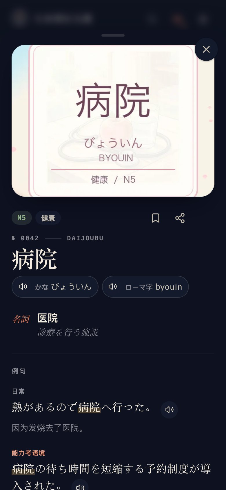

# 大米要扛几楼 日本語版 · Daijoubu

**把日语单词变成画面，让复习有迹可循。**

153 个 JLPT 词条 · 原创二次元插画 · 假名与罗马字 · 双声线日语朗读 · FSRS 间隔复习

[产品预览](#产品预览)　/　[学习方式](#学习方式)　/　[本地运行](#本地运行)　/　[开放数据](#开放数据)　/　[参与贡献](#参与贡献)

[](LICENSE) [](CONTENT_LICENSE.md)

---

大米要扛几楼 日本語版是一款以插画和语境为核心的 JLPT 背词应用。看画面理解词义，听发音建立联系，再用主动回忆和间隔复习巩固记忆。无需账号，学习进度保存在自己的设备上。

项目模块名 `daijoubu` 取自日语「大丈夫（だいじょうぶ）」的罗马字，也是中文名的谐音来源；拼写沿用词库里 `gakkou`、`juumin` 这一套转写规则。

> **与上游的关系**：本项目是 [designfuchen/word-atlas](https://github.com/designfuchen/word-atlas)（上游英文版）的日语复刻版。应用代码、界面、交互、WebGL2 词汇星图、四种练习题型和 FSRS 记忆算法与上游保持一致；学习语言从英语（雅思 / CEFR）换成日语（JLPT / 假名 / 罗马字）。日语词条、插画与录音均独立生成，代码与内容分别遵循下方的 MIT / CC BY 4.0 授权。

## 产品预览

### 一本可以听、可以练的日语单词图鉴

| 桌面 · 今日学习 | 桌面 · 词汇图鉴 |
| --- | --- |
| [](docs/assets/today-desktop.jpg) | [](docs/assets/atlas-desktop.jpg) |
| 每日计划，把注意力放在今天 | 153 个词按 JLPT 级别与 19 个话题整理 |

| 手机 · 今日学习 | 手机 · 词卡 |
| --- | --- |
| [](docs/assets/today-mobile.jpg) | [](docs/assets/word-mobile.jpg) |
| 手机端同样完整可用 | 二次元插画、假名、罗马字、释义与例句，在一张词卡里 |

### 学过的词，汇成自己的星图

[](docs/assets/galaxy.jpg)

19 个话题组成词汇星图。拖动旋转、滚动缩放，点击星星打开词卡；学习状态用不同亮度呈现。采用 WebGL2 渲染，不支持的设备提供降级显示。

## 学习方式

| 环节 | 你会做什么 |
| --- | --- |
| **看见** | 每个词配一幅二次元主题插画、假名与罗马字、中日释义、两条例句，以及搭配、词族和用法提示。 |
| **听见** | 切换标准与慢速两条日语声线，听词头与例句朗读。 |
| **想起** | 看义选词、看图补句、听音辨词、拼写（输入罗马字），逐步练习主动回忆。 |
| **复习** | FSRS 根据学习记录安排复习，目标记忆率可调。只有首次作答计入正确率。 |
| **积累** | 星图展示学习进度；打字练习独立统计；支持导出和恢复本地进度。 |

**本地优先。** 无需注册；看过的词条与媒体可缓存供离线使用。换设备前，请先导出进度备份。

**听发音、例句与界面声音**

拿 *学校（がっこう）* 举例，点开就能听：

标准朗读　[がっこう / gakkou](public/atlas/audio/uk/gakkou.mp3)　·　慢速朗读　[がっこう / gakkou](public/atlas/audio/us/gakkou.mp3)　·　例句朗读　[毎朝七時に学校へ行きます。](public/atlas/audio/ex/gakkou.mp3)

全部 153 个词都有标准与慢速两条词头朗读，两条例句也各配一条朗读，共 612 段录音。

### 环境声与交互声音

**开屏配音**　[「欢迎打开日语大门」](public/sfx/splash-voice.mp3)

**星图配音**　[「这是你的词汇星图。每学会一个词，就点亮一颗星。」](public/sfx/voice-galaxy-hello.mp3)

**星空音乐**　[一段可无缝循环的原创配乐](public/sfx/amb-stars.mp3)，默认陪你背词

**6 段环境声**　[雨天图书馆](public/sfx/amb-rain.mp3) · [清晨海岸](public/sfx/amb-sea.mp3) · [林间早晨](public/sfx/amb-forest.mp3) · [夜晚壁炉](public/sfx/amb-fire.mp3) · [远航船舱](public/sfx/amb-voyage.mp3) · [安静咖啡馆](public/sfx/amb-cafe.mp3)

**界面音效**　答对、答错、翻卡、打字、连胜、点亮星星……每个操作都有自己的声音；读单词时背景音会自动压低。

全部素材都在仓库里：插画在 `public/atlas/img/`，录音在 `public/atlas/audio/`，这两类按 CC BY 4.0 开放；界面声音和配乐在 `public/sfx/`，随应用一起提供。品牌插画在 `public/brand/`。

## 本地运行

需要 **Node.js 20+** 和 npm。仓库已包含全部插画与录音，无需联网、无需账号、无需密钥。

```bash
git clone https://github.com/ninetyhe-90/word-atlas-ja.git
cd Daijoubu
npm install --include=dev
npm run dev
```

打开 **http://localhost:5188**。

```bash
npm test             # 单元测试
npm run check:atlas  # 词库结构、分片、罗马字与媒体校验
npm run build        # 构建到 dist/
npm run preview      # 预览构建结果
```

子路径部署：`ATLAS_BASE=/words/ npm run build`，完整说明见 [部署文档](docs/deployment.md)。

如果本机环境设置了 `NODE_ENV=production` 或 `npm config set omit dev`，安装时必须显式加 `--include=dev`，否则 TypeScript、Vite 等构建工具不会被安装。

如果 IDE 的删除防护拦截了 Vite 清空 `dist/`（报错来自 `emptyDir` / `rmSync`），先执行 `rm -rf dist` 再构建即可；这是本机工具链限制，不是项目代码问题。

**技术栈**：React 19 · TypeScript · Vite · ts-fsrs · WebGL2

### 重新生成数据与素材

```bash
python3 -m pip install --user pykakasi   # 仅例句罗马字转写需要
npm run build:romaji                    # data/ja-romaji.json
npm run build:atlas                     # index.json、entries/*.json、完整 JSON/CSV
npm run gen:media                       # 二次元词卡 WebP 与四类日语朗读 MP3（macOS say + ffmpeg）
npm run check:atlas
```

`gen:media` 依赖 macOS 的日语语音 `Kyoko` 和 `ffmpeg`；脚本幂等，只补生成缺失的文件，加 `-- --force` 可全量重绘。词卡以 `public/brand/topic-*.webp` 的二次元插画为底图，其他平台可替换为任意日语 TTS，只要保持 `public/atlas/audio/{uk,us,ex,ex2}/<id>.mp3` 的路径约定。`npm run render:cards` 可用无头 Chromium 重绘横幅、社媒卡片和本文档的截图。详见 [内容流程](docs/pipeline.md)。

## 开放数据

不仅可以直接使用应用，也可以把词库用于自己的学习工具、Anki 牌组或研究项目。

| 资源 | 开源版内容 | 入口 |
| --- | --- | --- |
| 词条 | **153** 条，JLPT N5–N1、19 个话题 | [JSON](data/word-atlas-ja.json) · [CSV](data/word-atlas-ja.csv) |
| 例句 | **306** 条，日常与能力考语境，附中文翻译和罗马字 | [字段说明](docs/dataset.md) |
| 插画 | **153** 幅，512 px WebP，另有 160 px 缩略图 | [图片目录](public/atlas/img) |
| 录音 | **612** 段，标准 / 慢速 / 两条例句 | [音频目录](public/atlas/audio) |

```python
import json
from pathlib import Path

words = json.loads(Path("data/word-atlas-ja.json").read_text(encoding="utf-8"))
n2_work = [w for w in words if w["cefr"] == "N2" and w["topic"] == "work"]
```

**查看一条词条的数据结构（节选）**

```json
{
  "id": "gakkou",
  "w": "学校",
  "kana": "がっこう",
  "romaji": "gakkou",
  "senses": [{ "pos": "名詞", "zh": "学校", "en": "学ぶための場所" }],
  "ex": [
    { "en": "毎朝七時に学校へ行きます。", "zh": "每天早上七点去学校。", "romaji": "maiasa shichiji ni gakkou he iki masu" },
    { "en": "地域の学校図書館を住民に開放する取り組みが進んでいる。", "zh": "把地区学校图书馆向居民开放的举措正在推进。", "romaji": "chiiki no gakkou toshokan wo juumin ni kaihou suru torikumi ga susun deiru" }
  ],
  "col": ["学校に行く｜去学校", "学校を卒業する｜从学校毕业"],
  "fam": ["通学"],
  "syn": ["塾"],
  "tip": "「学校」多指中小学，大学一般说「大学」。",
  "cefr": "N5",
  "topic": "education"
}
```

为兼容上游数据结构，`uk` / `us` 字段分别存假名与罗马字，对应音频位也沿用 `uk`、`us`；`cefr` 字段的值为 JLPT 级别。

### 内容来源与局限

词表、释义、例句与中文翻译按统一规范整理；词卡由脚本按词条 id 确定性绘制，以对应话题的二次元插画为底图；朗读使用 macOS 日语语音 `Kyoko` 合成。内容经过自动结构与一致性校验，**尚未逐条人工审校**，可能出现释义、例句、插画或读音偏差。罗马字由 pykakasi 自动转写，个别复合词可能按分词切分（如 `kangae ru`）。它不是官方 JLPT 词表，也不承诺提分。

[词库格式](docs/dataset.md) · [内容生成流程](docs/pipeline.md) · [记忆模型](docs/learning-model.md)

## 参与贡献

发现问题时，请附上**词条 ID、复现步骤和预期结果**。内容纠错如有词典或其他可靠依据，也请一并提供。

- [报告问题](https://github.com/ninetyhe-90/word-atlas-ja/issues/new)：词条纠错、界面问题或使用建议。
- [贡献指南](CONTRIBUTING.md)：数据同步、代码规范和提交前检查。
- [安全政策](SECURITY.md)：安全问题的反馈方式。

## 授权

| 范围 | 许可 |
| --- | --- |
| 应用代码 | [MIT](LICENSE)（保留上游版权声明） |
| 词条文本、插画与词条录音 | [CC BY 4.0](CONTENT_LICENSE.md)，署名 Daijoubu contributors |
| 第三方依赖与字体 | 遵循各自许可 |

---

本项目由[@ninetyhe-90](https://github.com/ninetyhe-90) 维护。

如果大米要扛几楼 日本語版对你有用，欢迎 Star，或把它分享给正在学日语的朋友。
